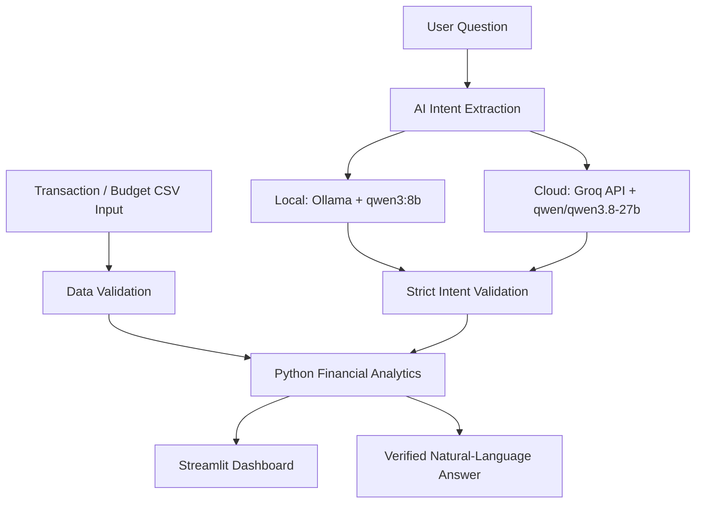

# FinSight — AI-Powered Business Financial Analytics

FinSight helps small businesses analyze transactions, monitor cash flow, compare budgets with actual expenses, and explore financial data through an AI-powered assistant.

**[Live Demo](https://finsight-analytics-project.streamlit.app/)**

Python · Pandas · Streamlit · Plotly · Ollama · Qwen3 · Groq

## Screenshots

Screenshots use the synthetic Lumen Digital Studio dataset.

**Financial Dashboard**


**Budget vs. Actual**


**AI Financial Assistant**


## Key Features

- Upload and validate transaction and monthly budget CSVs, locally or in the live demo.
- Monitor income, expenses, and net cash flow with clear KPI cards.
- Analyze monthly financial trends and income/expense category breakdowns.
- Filter transactions by date, category, and type; export matching records as CSV.
- Compare planned budgets with actual expenses, including monetary and percentage variances.
- Ask natural-language questions about KPIs, categories, monthly comparisons, and budgets.
- Receive clear answers backed by validated Python calculations and a verification indicator.

## Architecture



Both providers extract operations and parameters; Python calculates financial values and formats deterministic answers.
The LLM never supplies figures. Dates/categories define the analysis scope; types filter only the explorer/export.

## Technology Stack

| Technology | Role |
| --- | --- |
| Python | Core application |
| Pandas | Data processing and financial analytics |
| Streamlit | Interactive dashboard and session-based chat |
| Plotly | Financial data visualization |
| Ollama + Qwen3 8B (`qwen3:8b`) | Local AI intent extraction |
| Groq + hosted Qwen (`qwen/qwen3.8-27b`) | Cloud AI intent extraction |
| Pytest | Automated verification |

## Run Locally

Use Python 3.12 on Linux/macOS:

```bash
git clone https://github.com/turkiasma/finsight-financial-analytics.git
cd finsight-financial-analytics

python3 -m venv .venv
source .venv/bin/activate
pip install -r requirements.txt
```

Install [Ollama](https://ollama.com/) and start its service (`ollama serve` if needed), then run:

```bash
ollama pull qwen3:8b
export AI_PROVIDER=ollama
streamlit run app.py
```

The dashboard works without Ollama; local AI chat requires its service and model.
The deployed application uses Groq. For Streamlit Cloud, select Python 3.12 and
`app.py`, then configure these values privately in **Streamlit Secrets**:

```toml
AI_PROVIDER = "groq"
GROQ_MODEL = "qwen/qwen3.8-27b"
GROQ_API_KEY = "<your-private-Groq-key>"
```

The key above is a placeholder. Keep real credentials in private Streamlit Secrets
or an ignored local `.streamlit/secrets.toml`, never in Git. Environment variables
override Secrets. Groq rate limits apply; cloud chat allows 20 attempts per session.

## CSV Input Format

**Transactions**

```csv
date,description,category,type,amount
2026-01-05,Website development service,Service Revenue,Income,2500.00
2026-01-07,Monthly office rent,Rent,Expense,650.00
```

**Monthly budgets**

```csv
month,category,budget_amount
2026-01,Marketing,500.00
2026-01,Rent,650.00
```

Amounts are **EUR**, with up to two decimal places; transactions must be positive.
Types are `Income` or `Expense`. Income categories: Product Sales, Service Revenue,
Subscription Revenue. Expense categories: Rent, Salaries, Marketing, Software, Utilities, Supplies.
Categories are case-sensitive and must match the type. Budgets must be non-negative,
with one entry per month/category. Custom transactions never silently inherit sample budgets.
Synthetic [transactions](data/sample_transactions.csv) and [budgets](data/sample_budgets.csv)
are included for immediate exploration.

## Testing

```bash
python -m pytest -q
python scripts/validate_phase1.py
python scripts/validate_phase2.py
```

The **223 automated tests** cover calculations, CSV validation, filters, budgets,
AI adapters, and chat. They run without live AI or private credentials. Local Qwen3
and hosted Groq inference were also verified independently. To check the local model,
run `python scripts/validate_ai.py`.

## Privacy and Financial Scope

Sample data is synthetic. Do not upload confidential financial or personal data to the public demo.
Streamlit processes uploaded CSVs. Cloud AI receives your question and limited intent
metadata, without attached transaction or budget datasets; anything typed into a
question is transmitted. Net cash flow is not accounting net profit. FinSight is an
analytics demonstration, not professional financial advice.
